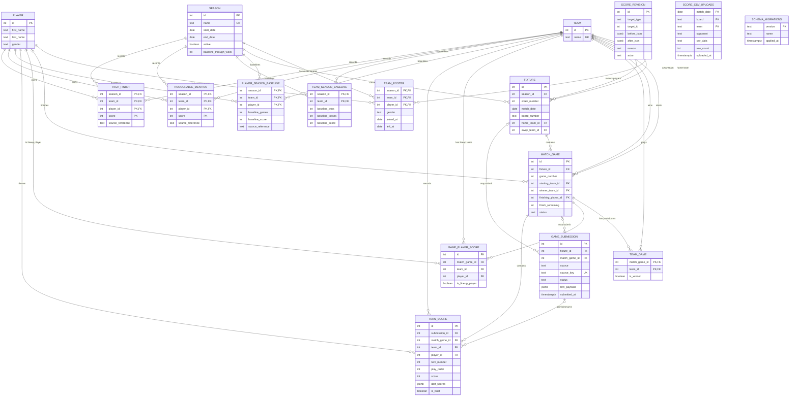

# Database Schema and Relationships

This document describes the PostgreSQL tables created and used by the KSC Darts League application. The schema is created through the forward-only SQL migrations in [`migrations/`](migrations/) and support tables initialized by the server.

The primary source of truth for SQL is the migration and server code. Use this document as a visual and conceptual guide.

## Entity relationship diagram

## How the score data is linked

The application separates stable identity, scheduled matches, normalized games, and import/audit data:

1. A `season` contains teams and fixtures.
2. `team_roster` is the season-specific join table linking `season`, `team`, and `player`. It also retains roster gender and optional join/leave dates.
3. A `fixture` represents one scheduled board match and belongs to a season. It points to one home team and one away team.
4. A `fixture` has up to seven `match_game` rows, one for each possible game. Each game records its starting team, winner, finishing player, finish remaining score, and status.
5. `team_game` is the two-team participation join for a match game.
6. `game_player_score` records the four-player lineup and identifies the team and player for each lineup entry.
7. `game_submission` records each CSV, browser, admin, or workbook submission and its acceptance status. It can point to a fixture and/or match game.
8. `turn_score` stores the normalized throw totals and optional dart details for a player in a match game. Browser submissions may also set `submission_id` and `play_order`.

## Baselines and historical records

The workbook import tables preserve established totals before live post-baseline submissions begin:

- `player_season_baseline` stores preexisting player totals for a season/team combination.
- `team_season_baseline` stores preexisting team totals for a season/team combination.
- `honourable_mention` stores individual Honourable Mention scores imported from the workbook.
- `high_finish` stores individual 50+ finish records imported from the workbook.

The season-level `baseline_through_week` value controls where live database totals begin and protects imported history from later overwrites.

## Submission and audit tables

- `game_submission` is the normalized audit record for league submissions. Its `source` is `csv`, `browser`, `admin`, or `workbook`, and `status` is `pending`, `accepted`, `rejected`, or `superseded`.
- `turn_score.submission_id` links normalized turns back to the submission that created them.
- `score_revision` stores append-style edits to any target. It is polymorphic: `target_type` identifies the affected record type and `target_id` identifies that record. It has no PostgreSQL foreign key because it can refer to several target tables.
- `score_csv_uploads` is the legacy compatibility/audit table created outside the numbered migrations. It uses `(match_date, board, team)` as its primary key and has no foreign-key relationships to the normalized schema.
- `schema_migrations` records migration versions already applied. It is managed by [`db/migrate.js`](db/migrate.js).

## Cascade and deletion behavior

The foreign keys use intentional deletion rules:

- Season deletion cascades through season-specific rosters and baseline/history rows.
- Fixture deletion is restricted if any live game references it.
- Match-game deletion cascades through team participants, lineup entries, submissions, and turns.
- Submission deletion cascades through linked normalized turn rows.
- Team, player, and season deletions generally cascade for junction and baseline records, while live fixture/game references use `ON DELETE RESTRICT`.

Before deleting or merging records, use the admin tools or a tested database script so submissions and report totals remain consistent.

## Migration documentation

The schema is applied in this order:

1. [`migrations/001_core_league_schema.sql`](migrations/001_core_league_schema.sql) - core identities, fixtures, games, submissions, turns, and revisions.
2. [`migrations/002_season_stat_baselines.sql`](migrations/002_season_stat_baselines.sql) - season baseline cutoff and team/player baselines.
3. [`migrations/003_remove_team_roster_limit.sql`](migrations/003_remove_team_roster_limit.sql) - removes the former team roster limit.
4. [`migrations/004_add_turn_play_order.sql`](migrations/004_add_turn_play_order.sql) - adds browser player turn ordering.
5. [`migrations/005_honourable_mentions.sql`](migrations/005_honourable_mentions.sql) - imported Honourable Mentions.
6. [`migrations/006_high_finishes.sql`](migrations/006_high_finishes.sql) - imported 50+ finishes.
